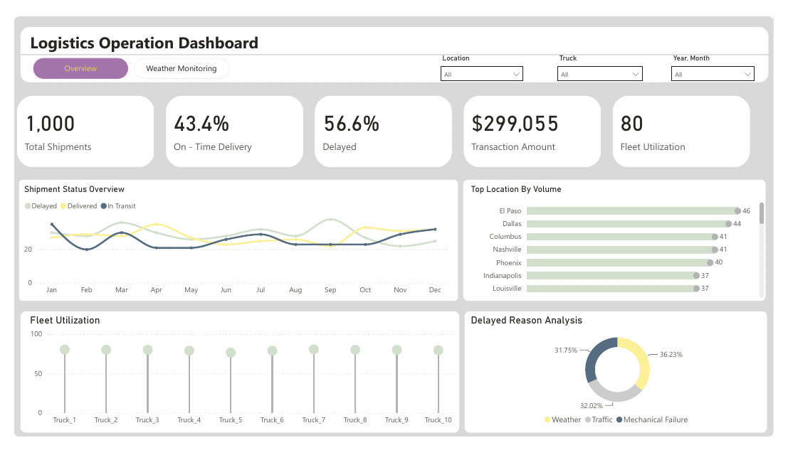

# Logistics Operations Dashboard

Power BI dashboard for shipment status, on-time delivery, fleet utilization, delay reasons and weather monitoring.

## What it shows
- 1,000 shipments: on-time vs delayed vs in transit, with transaction amount
- Top locations by volume and per-truck fleet utilization
- Delay reason analysis (weather, traffic, mechanical failure)
- Second page for temperature and humidity monitoring

## Files
- `Logistics Dashboard.pbix`: Power BI report (open in Power BI Desktop)
- `Logistics Dashboard.pdf`: exported PDF of the report
- `data/`: source data. logistics_dataset.xlsx (included).

## Tools
Power BI, DAX, Power Query.

## Author
Asad Ullah, Data Analyst and Power BI Developer, Dammam, Saudi Arabia
[LinkedIn](https://linkedin.com/in/asadullah44) | [Portfolio](https://asadullah-the-analyst.netlify.app) | [GitHub](https://github.com/asadullah43)
